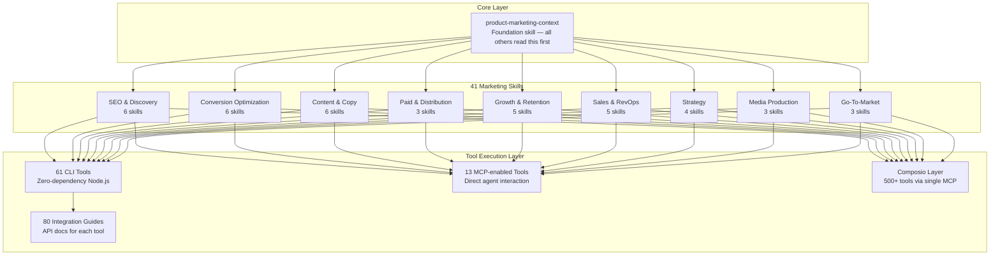

# Marketing Skills — Complete Codebase Analysis

## Executive Summary

**Marketing Skills** is an open-source AI agent skills library by [Corey Haines](https://corey.co) that turns any AI coding agent into a full-stack marketing team. It contains **41 marketing skills** (structured markdown instruction sets), **61 CLI tools** (zero-dependency Node.js scripts), **80 integration guides**, and a **Composio-based integration layer** connecting to 500+ tools via MCP. It works cross-agent (Claude Code, Cursor, Windsurf, Codex, etc.) and follows the open [Agent Skills spec](https://agentskills.io).

This is **not** a traditional software application — it's an **intelligence layer** for AI agents, giving them specialized marketing expertise and real tool access.

---

## 1. What the Codebase Does

### 1.1 Architecture Overview



### 1.2 The Three Pillars

| Pillar | What | Count | Purpose |
|--------|------|-------|---------|
| **Skills** | Markdown instruction files (SKILL.md) | 41 | Give AI agents expert marketing knowledge, frameworks, and workflows |
| **CLI Tools** | Standalone Node.js scripts | 61 | Execute real actions on marketing platforms (send emails, pull analytics, manage ads) |
| **Integration Guides** | Markdown API documentation | 80 | Detailed setup, auth, endpoints, and common operations for each tool |

### 1.3 How Skills Work

Each skill is a structured markdown file with:
1. **YAML Frontmatter** — `name`, `description` (with trigger phrases for auto-activation), `version`
2. **Expert Persona** — Tells the AI *who* it becomes (e.g., "You are a conversion rate optimization expert")
3. **Context Gathering** — What to ask the user before proceeding
4. **Frameworks & Methodology** — Step-by-step professional processes
5. **Output Format** — Structured deliverable templates
6. **Tool References** — Links to relevant CLI tools and integrations
7. **Cross-References** — Links to related skills for hand-off

> [!IMPORTANT]
> The `product-marketing-context` skill is the **foundation** — every other skill checks for `.agents/product-marketing-context.md` first. This file captures ICP, positioning, competitive landscape, brand voice, proof points, and goals. It's the "single source of truth" that prevents repetitive context-gathering.

### 1.4 How CLI Tools Work

All 61 CLI tools follow an identical pattern:
- **Zero dependencies** — Node 18+ only, uses native `fetch`
- **JSON output** — Machine-readable, pipeable to `jq`
- **Env var auth** — `{TOOL}_API_KEY` pattern
- **Consistent commands** — `{tool} <resource> <action> [options]`
- **Dry run mode** — `--dry-run` previews without sending
- **No npm install** — Single-file scripts, just `node tools/clis/{tool}.js`

### 1.5 How Integrations Connect

Three integration methods:
1. **CLI Tools** (61) — Direct script execution by the agent
2. **MCP Servers** (13) — Agent-native tool access (GA4, Stripe, Mailchimp, Google Ads, Resend, Zapier, etc.)
3. **Composio** — OAuth proxy giving MCP access to HubSpot, Salesforce, Meta Ads, LinkedIn Ads, Google Sheets, Slack, Notion, and 500+ more

---

## 2. Complete Use Case Inventory

### 2.1 Conversion Optimization (6 skills)

| Skill | What It Does | Key Capability |
|-------|-------------|----------------|
| [page-cro](file:///d:/cool/Skills/marketingskills-main/marketingskills/skills/page-cro/SKILL.md) | Analyzes any marketing page and gives prioritized CRO recommendations | 7-dimension analysis framework: value prop, headlines, CTAs, visual hierarchy, trust signals, objection handling, friction points |
| [signup-flow-cro](file:///d:/cool/Skills/marketingskills-main/marketingskills/skills/signup-flow-cro/SKILL.md) | Optimizes registration/trial activation flows | Multi-step flow analysis, form field reduction, social login strategy |
| [onboarding-cro](file:///d:/cool/Skills/marketingskills-main/marketingskills/skills/onboarding-cro/SKILL.md) | Optimizes post-signup activation and time-to-value | Onboarding checklists, activation metrics, aha-moment identification |
| [form-cro](file:///d:/cool/Skills/marketingskills-main/marketingskills/skills/form-cro/SKILL.md) | Optimizes lead capture, contact, and non-signup forms | Field optimization, progressive profiling, multi-step forms |
| [popup-cro](file:///d:/cool/Skills/marketingskills-main/marketingskills/skills/popup-cro/SKILL.md) | Creates/optimizes modals, slide-ins, exit-intent popups | Timing triggers, targeting rules, copy formulas |
| [paywall-upgrade-cro](file:///d:/cool/Skills/marketingskills-main/marketingskills/skills/paywall-upgrade-cro/SKILL.md) | Optimizes in-app paywalls, upgrade screens, feature gates | Usage-based triggers, plan comparison, trial expiration flows |

### 2.2 Content & Copy (6 skills)

| Skill | What It Does | Key Capability |
|-------|-------------|----------------|
| [copywriting](file:///d:/cool/Skills/marketingskills-main/marketingskills/skills/copywriting/SKILL.md) | Writes marketing copy for any page type | Headline formulas, CTA templates, page structure frameworks, voice/tone calibration |
| [copy-editing](file:///d:/cool/Skills/marketingskills-main/marketingskills/skills/copy-editing/SKILL.md) | Reviews and polishes existing marketing copy | Line-by-line editing, clarity principles, buzzword detection |
| [cold-email](file:///d:/cool/Skills/marketingskills-main/marketingskills/skills/cold-email/SKILL.md) | Writes B2B cold emails and follow-up sequences | Personalization frameworks, subject lines, reply-rate optimization |
| [email-sequence](file:///d:/cool/Skills/marketingskills-main/marketingskills/skills/email-sequence/SKILL.md) | Creates automated email flows (welcome, nurture, re-engagement, onboarding) | Full sequence design with timing, subject lines, copy, CTAs, metrics |
| [social-content](file:///d:/cool/Skills/marketingskills-main/marketingskills/skills/social-content/SKILL.md) | Creates social media content for LinkedIn, X, Instagram, TikTok | Content pillars, hook formulas, repurposing system, content calendars, short-form video scripting |
| [content-strategy](file:///d:/cool/Skills/marketingskills-main/marketingskills/skills/content-strategy/SKILL.md) | Plans what content to create, topic clusters, editorial calendars | Keyword-driven planning, content gap analysis, pillar/cluster strategy |

### 2.3 SEO & Discovery (6 skills)

| Skill | What It Does | Key Capability |
|-------|-------------|----------------|
| [seo-audit](file:///d:/cool/Skills/marketingskills-main/marketingskills/skills/seo-audit/SKILL.md) | Full technical + on-page SEO audit | Crawlability, indexation, Core Web Vitals, hreflang/i18n, E-E-A-T, structured reports |
| [ai-seo](file:///d:/cool/Skills/marketingskills-main/marketingskills/skills/ai-seo/SKILL.md) | Optimizes content for AI search engines (ChatGPT, Perplexity, Google AI Overviews) | AEO, GEO, LLMO frameworks for appearing in AI-generated answers |
| [programmatic-seo](file:///d:/cool/Skills/marketingskills-main/marketingskills/skills/programmatic-seo/SKILL.md) | Creates SEO pages at scale using templates + data | Template design, data sourcing, internal linking, deduplication |
| [site-architecture](file:///d:/cool/Skills/marketingskills-main/marketingskills/skills/site-architecture/SKILL.md) | Plans page hierarchy, navigation, URL structure | Information architecture, internal linking strategy, hub-and-spoke |
| [competitor-alternatives](file:///d:/cool/Skills/marketingskills-main/marketingskills/skills/competitor-alternatives/SKILL.md) | Creates competitor comparison and "alternatives to" pages | SEO-optimized comparison tables, feature matrices |
| [schema-markup](file:///d:/cool/Skills/marketingskills-main/marketingskills/skills/schema-markup/SKILL.md) | Implements JSON-LD structured data | FAQ, Product, Organization, Article, Breadcrumb schemas |

### 2.4 Paid Advertising & Distribution (3 skills)

| Skill | What It Does | Key Capability |
|-------|-------------|----------------|
| [paid-ads](file:///d:/cool/Skills/marketingskills-main/marketingskills/skills/paid-ads/SKILL.md) | Campaign strategy across Google, Meta, LinkedIn, TikTok, X | Platform selection, audience targeting, budget allocation, retargeting funnels, optimization levers |
| [ad-creative](file:///d:/cool/Skills/marketingskills-main/marketingskills/skills/ad-creative/SKILL.md) | Generates ad copy at scale and iterates based on performance data | RSA headlines, Meta primary text, LinkedIn ads — bulk CSV output, performance analysis loop |
| [ab-test-setup](file:///d:/cool/Skills/marketingskills-main/marketingskills/skills/ab-test-setup/SKILL.md) | Designs A/B tests and experimentation programs | Sample size calculation, hypothesis design, statistical rigor |

### 2.5 Growth & Retention (5 skills)

| Skill | What It Does | Key Capability |
|-------|-------------|----------------|
| [referral-program](file:///d:/cool/Skills/marketingskills-main/marketingskills/skills/referral-program/SKILL.md) | Designs referral and affiliate programs | Referral loops, incentive structures, double-sided rewards, fraud prevention |
| [free-tool-strategy](file:///d:/cool/Skills/marketingskills-main/marketingskills/skills/free-tool-strategy/SKILL.md) | Plans free marketing tools (calculators, generators) | Tool selection, SEO value, lead capture, build vs. buy |
| [churn-prevention](file:///d:/cool/Skills/marketingskills-main/marketingskills/skills/churn-prevention/SKILL.md) | Reduces churn with cancel flows, save offers, dunning | Dynamic save offers matched to cancel reasons, health scores, payment recovery (30-50% of churn is involuntary) |
| [community-marketing](file:///d:/cool/Skills/marketingskills-main/marketingskills/skills/community-marketing/SKILL.md) | Builds and leverages online communities | Community platform selection, engagement playbooks, content strategy |
| [co-marketing](file:///d:/cool/Skills/marketingskills-main/marketingskills/skills/co-marketing/SKILL.md) | Finds co-marketing partners and plans joint campaigns | Partner identification, co-webinars, content swaps, cross-promotions |

### 2.6 Sales & Go-To-Market (5 skills)

| Skill | What It Does | Key Capability |
|-------|-------------|----------------|
| [revops](file:///d:/cool/Skills/marketingskills-main/marketingskills/skills/revops/SKILL.md) | Revenue operations — connects marketing, sales, and CS | Lead lifecycle stages, scoring models, routing rules, pipeline management, CRM automation, SLAs |
| [sales-enablement](file:///d:/cool/Skills/marketingskills-main/marketingskills/skills/sales-enablement/SKILL.md) | Creates sales collateral | Pitch decks, one-pagers, objection handling docs, demo scripts, battle cards |
| [launch-strategy](file:///d:/cool/Skills/marketingskills-main/marketingskills/skills/launch-strategy/SKILL.md) | Plans product launches and feature announcements | Launch timelines, channel coordination, Product Hunt strategy |
| [pricing-strategy](file:///d:/cool/Skills/marketingskills-main/marketingskills/skills/pricing-strategy/SKILL.md) | Pricing, packaging, and monetization decisions | Value metrics, competitive pricing, plan tier design, annual discounting |
| [directory-submissions](file:///d:/cool/Skills/marketingskills-main/marketingskills/skills/directory-submissions/SKILL.md) | Submits products to directories for backlinks and discovery | Product Hunt, G2, AI directories, startup directories |

### 2.7 Strategy & Research (4 skills)

| Skill | What It Does | Key Capability |
|-------|-------------|----------------|
| [marketing-ideas](file:///d:/cool/Skills/marketingskills-main/marketingskills/skills/marketing-ideas/SKILL.md) | 140+ SaaS marketing ideas across all channels | Categorized by effort, cost, and impact |
| [marketing-psychology](file:///d:/cool/Skills/marketingskills-main/marketingskills/skills/marketing-psychology/SKILL.md) | Applies behavioral science to marketing | Cognitive biases, persuasion frameworks, pricing psychology |
| [customer-research](file:///d:/cool/Skills/marketingskills-main/marketingskills/skills/customer-research/SKILL.md) | Conducts and synthesizes customer research | Interview scripts, survey design, voice-of-customer extraction |
| [competitor-profiling](file:///d:/cool/Skills/marketingskills-main/marketingskills/skills/competitor-profiling/SKILL.md) | Deep competitive intelligence from competitor URLs | Feature mapping, positioning analysis, traffic analysis |

### 2.8 Media Production (3 skills)

| Skill | What It Does | Key Capability |
|-------|-------------|----------------|
| [image](file:///d:/cool/Skills/marketingskills-main/marketingskills/skills/image/SKILL.md) | AI image generation for marketing (blog heroes, social graphics, product shots) | Gemini Nano Banana Pro, Flux, Ideogram, optimization |
| [video](file:///d:/cool/Skills/marketingskills-main/marketingskills/skills/video/SKILL.md) | AI video production using Hyperframes, HeyGen, Veo, Runway, Kling | Programmatic video from HTML/CSS, AI avatars, templated production |
| [aso-audit](file:///d:/cool/Skills/marketingskills-main/marketingskills/skills/aso-audit/SKILL.md) | App Store Optimization audit | App Store/Google Play listing optimization, keyword strategy |

### 2.9 Foundation

| Skill | What It Does | Key Capability |
|-------|-------------|----------------|
| [product-marketing-context](file:///d:/cool/Skills/marketingskills-main/marketingskills/skills/product-marketing-context/SKILL.md) | Creates the foundational context document read by all other skills | 12-section deep dive: product overview, ICP, personas, pain points, competitive landscape, differentiation, objections, switching dynamics, customer language, brand voice, proof points, goals |

---

## 3. Tool Integration Ecosystem (61 CLIs + 80 Guides)

### By Category

| Category | CLI Tools | Integration Guides | Examples |
|----------|-----------|-------------------|----------|
| **Analytics** | 7 | 7 | GA4, Mixpanel, Amplitude, PostHog, Segment, Adobe Analytics, Plausible |
| **SEO** | 5 | 5 | Google Search Console, SEMrush, Ahrefs, DataForSEO, Keywords Everywhere |
| **Email Marketing** | 11 | 12 | Mailchimp, Customer.io, SendGrid, Resend, Kit, Beehiiv, Klaviyo, Postmark, Brevo, ActiveCampaign, NitroSend |
| **Email Outreach** | 4 | 4 | Hunter, Snov, Lemlist, Instantly |
| **Advertising** | 4 | 4 | Google Ads, Meta Ads, LinkedIn Ads, TikTok Ads |
| **CRM** | 3 | 3 | HubSpot, Salesforce, Close |
| **Payments** | 2 | 2 | Stripe, Paddle |
| **Referral/Affiliate** | 4 | 5 | Rewardful, Tolt, Mention Me, PartnerStack, Dub.co |
| **Data Enrichment** | 4 | 4 | Clearbit, Apollo, ZoomInfo, Clay |
| **Social** | 1 | 1 | Buffer |
| **Video** | 1 | 3 | Wistia, HeyGen, Hyperframes |
| **CMS/Commerce** | 0 | 6 | Shopify, WordPress, Webflow, Sanity, Contentful, Strapi |
| **Reviews** | 2 | 2 | Trustpilot, G2 |
| **CRO/Testing** | 2 | 2 | Hotjar, Optimizely |
| **Scheduling** | 2 | 2 | Calendly, SavvyCal |
| **Forms/Messaging** | 2 | 2 | Typeform, Intercom |
| **Automation** | 1 | 1 | Zapier |
| **Webinar** | 2 | 2 | Demio, Livestorm |
| **Push** | 1 | 1 | OneSignal |
| **Partner Ecosystem** | 1 | 2 | Crossbeam, Introw |
| **Other** | 4 | 10+ | Pendo, SimilarWeb, AirOps, various others |

---

## 4. How Everything Connects (Skill Cross-References)

The skills form an interconnected graph — not a flat list. Key connection patterns:

```
copywriting ↔ page-cro ↔ ab-test-setup
revops ↔ sales-enablement ↔ cold-email
seo-audit ↔ schema-markup ↔ ai-seo
customer-research → copywriting, page-cro, competitor-alternatives
email-sequence ↔ churn-prevention ↔ onboarding-cro
paid-ads ↔ ad-creative ↔ analytics-tracking
referral-program ↔ launch-strategy ↔ pricing-strategy
```

This means an AI agent can **chain skills together** — e.g., a user says "launch my new feature" and the agent can invoke `launch-strategy` → `copywriting` → `email-sequence` → `social-content` → `paid-ads` → `ad-creative` → `analytics-tracking` in a coordinated workflow.

---

## 5. Product Opportunities — What You Can Build

Based on the capabilities in this codebase, here are **detailed product concepts** that would make these use cases accessible to real users:

---

### 🚀 Product 1: AI Marketing Co-Pilot (SaaS Dashboard)

**What**: A web application that wraps these 41 skills into a user-friendly marketing dashboard with a chat interface.

**Core Features**:
- **Onboarding Wizard** — walks users through `product-marketing-context` to set up their product/audience/positioning
- **Task-Based UI** — cards for each marketing domain (SEO, Ads, Email, CRO, etc.) that trigger the right skill
- **Chat Interface** — "Audit my homepage for CRO" triggers `page-cro`; "Write a welcome email sequence" triggers `email-sequence`
- **Connected Accounts** — OAuth integration panel to connect GA4, Stripe, Mailchimp, Google Ads, Meta, etc.
- **Asset Library** — Stores generated copy, email sequences, ad variations, social posts
- **Performance Dashboard** — Pulls real data from connected tools to show what's working

**Revenue Model**: Freemium ($0 for 5 tasks/month) → Pro ($49/month) → Team ($149/month)

**Competitive Edge**: Unlike Jasper (content only) or HubSpot (CRM + basics), this covers the *entire* marketing stack with expert-level depth in each domain.

---

### 📱 Product 2: Social Content Generator & Scheduler

**What**: A dedicated tool for social media content creation, repurposing, and scheduling — powered by the `social-content`, `copywriting`, and `image` skills.

**Core Features**:
- **Content Pillar Builder** — Set up 3-5 pillars; AI generates posts for each
- **Repurposing Engine** — Paste a blog URL, podcast transcript, or newsletter → get 10-15 social posts across platforms
- **Hook Generator** — Generates attention-grabbing first lines using the 16+ hook formulas in `social-content`
- **Platform Adaptor** — Auto-formats for LinkedIn (carousels), X (threads), Instagram (captions + Reels scripts), TikTok (video scripts) and Facebook
- **Content Calendar** — Visual weekly/monthly calendar with drag-and-drop scheduling
- **Buffer/HubSpot Integration** — Uses the CLI tools to schedule posts directly
- **AI Image Generation** — Generate social graphics using the `image` skill
- **Short-Form Video Scripts** — Generates scripts following the 3-second rule, problem-solution, list, and tutorial structures

**Revenue Model**: $29/month individual, $79/month team

---

### 🛍️ Product 3: E-Commerce Marketing Suite

**What**: A marketing platform specifically for Shopify/e-commerce stores, combining the store integration with marketing automation.

**Core Features**:
- **Store Connection** — Shopify, WooCommerce, or Webflow integration via CLI tools
- **Product Page CRO** — Scans product pages using `page-cro` and gives specific recommendations
- **Email Flows** — Auto-generates abandoned cart, post-purchase, win-back, and review request sequences using `email-sequence`
- **Ad Campaign Builder** — Generates Google Shopping, Meta, and TikTok ad creative using `ad-creative` and `paid-ads`
- **Churn/Dunning** — Failed payment recovery and subscription churn prevention using `churn-prevention`
- **Referral Program** — Sets up customer referral programs using `referral-program` + Rewardful/Tolt
- **SEO Automation** — Product schema markup using `schema-markup`, collection page optimization using `seo-audit`
- **Klaviyo/Mailchimp Sync** — Uses CLI tools to push segments and campaigns

**Revenue Model**: $99/month per store, or % of recovered revenue

---

### 📊 Product 4: Ad Creative & Campaign Manager

**What**: A tool focused entirely on paid advertising — from strategy to creative generation to performance optimization.

**Core Features**:
- **Campaign Planner** — Uses `paid-ads` to recommend platform, budget, targeting
- **Bulk Creative Generator** — Uses `ad-creative` to generate 50-100+ headline/description variations per campaign
- **Performance Analyzer** — Pulls data from Google Ads, Meta, LinkedIn, TikTok CLIs → identifies winners/losers
- **Iteration Engine** — Feeds performance data back into `ad-creative` to generate new variations that extend winning patterns
- **A/B Test Designer** — Uses `ab-test-setup` to design statistically rigorous creative tests
- **Landing Page Optimizer** — Scans ad landing pages with `page-cro` for message-match and conversion issues
- **CSV Export** — Bulk export creative in platform-ready format for direct upload
- **Budget Optimizer** — Recommendations on spend allocation across campaigns and platforms

**Revenue Model**: $79/month for 3 accounts → $199/month unlimited

---

### 🔄 Product 5: Revenue Operations Platform (RevOps-as-a-Service)

**What**: An automated RevOps system that connects CRM, marketing, and sales into a unified pipeline.

**Core Features**:
- **Lead Scoring Engine** — Implements the fit + engagement scoring model from `revops`
- **Routing Automation** — Round-robin, territory, ABM routing with SLA tracking
- **Lifecycle Dashboard** — Subscriber → Lead → MQL → SQL → Opportunity → Customer visualization
- **Handoff Alerts** — Real-time notifications when leads need follow-up, with SLA tracking
- **Pipeline Analytics** — Stage conversion rates, velocity, coverage ratio, win rates
- **CRM Sync** — HubSpot, Salesforce, Close integration via CLIs + Composio
- **Deal Desk Workflow** — Approval chains for non-standard deals
- **Data Hygiene** — Automated dedup, enrichment via Clearbit/Apollo/ZoomInfo CLIs

**Revenue Model**: $299/month per team (seats-based)

---

### 🚀 Product 6: Product Launch Platform

**What**: An end-to-end launch management tool combining multiple skills.

**Core Features**:
- **Launch Timeline Builder** — Uses `launch-strategy` to create phased launch plans
- **Copy Generator** — Homepage copy, feature page copy, announcement emails, social posts — all generated from a single brief
- **Directory Submission Manager** — Tracks submissions to Product Hunt, G2, AI directories using `directory-submissions`
- **Email Campaign Builder** — Launch announcement sequences using `email-sequence`
- **Social Campaign** — Coordinated social content across platforms using `social-content`
- **Analytics Setup** — Configures tracking for launch events using `analytics-tracking`
- **PR/Outreach** — Cold email templates for press and influencer outreach using `cold-email`

**Revenue Model**: $99 per launch or $49/month subscription

---

### 🛡️ Product 7: Churn Prevention & Retention Engine

**What**: A dedicated SaaS retention tool powered by the `churn-prevention` skill.

**Core Features**:
- **Cancel Flow Builder** — Visual drag-and-drop builder for survey → offer → confirmation flows
- **Dynamic Save Offers** — Match offers to cancel reasons automatically (discount for "too expensive", pause for "not using enough")
- **Health Score Dashboard** — Tracks login frequency, feature usage, support sentiment → predicts churn risk
- **Dunning Automation** — Smart retry logic + 4-email dunning sequence for failed payments
- **Win-Back Campaigns** — Automated email sequences triggered post-cancellation
- **Stripe/Paddle Integration** — Direct billing system connection via CLI tools
- **A/B Testing** — Test different cancel flows, offers, and copy

**Revenue Model**: % of saved revenue (pay for performance) or $199/month flat

---

### 🔗 Product 8: Marketing Integrations Hub

**What**: A universal marketing data layer — connect all your tools and let AI orchestrate across them.

**Core Features**:
- **61 Pre-Built Connectors** — Every CLI tool becomes a one-click integration
- **Cross-Tool Workflows** — "Pull my GA4 top pages → run SEO audit → generate meta descriptions → push to Webflow"
- **Unified Dashboard** — Pull data from GA4, Stripe, Mailchimp, Google Ads into one view
- **Zapier-Style Automations** — Trigger → Condition → Action workflows powered by skill logic
- **Data Enrichment Pipeline** — Feed leads through Clearbit → Apollo → ZoomInfo waterfall
- **Composio Backend** — 500+ additional tools via managed OAuth

**Revenue Model**: $49/month (5 integrations) → $149/month (unlimited)

---

## 6. Summary of Key Technical Assets

| Asset | Count | Technology |
|-------|-------|------------|
| Marketing Skills | 41 | Markdown (Agent Skills spec) |
| CLI Tools | 61 | Node.js 18+, zero-dependency |
| Integration Guides | 80 | Markdown API documentation |
| MCP-Enabled Tools | 13 | Model Context Protocol |
| Composio Toolkits | 500+ | Managed OAuth + MCP |
| Reference Documents | 50+ | Deep-dive docs in skill `/references/` dirs |
| Validation Scripts | 2 | Bash (spec compliance checking) |
| Plugin Manifest | 1 | JSON (Claude Code marketplace) |

---

## 7. Key Design Patterns

1. **Context-First Architecture** — All skills read `product-marketing-context.md` before acting, ensuring consistency
2. **Trigger-Based Activation** — Rich description fields with trigger phrases enable auto-skill selection
3. **Cross-Referencing** — Skills link to related skills, creating intelligent workflow chains
4. **Tool-Skill Coupling** — Skills reference specific CLI tools and integration guides for execution
5. **Output Standardization** — Every skill defines structured output formats (tables, templates, checklists)
6. **Versioned and Updatable** — `VERSIONS.md` enables automatic update checking once per session
7. **Agent-Agnostic** — Works on Claude Code, Cursor, Windsurf, Codex, and any Agent Skills-compatible tool
8. **Progressive Disclosure** — Main SKILL.md < 500 lines, with detailed docs in `references/` subdirectories

> [!TIP]
> The strongest product opportunity is **Product 1 (AI Marketing Co-Pilot)** — it leverages the entire codebase, provides the broadest market appeal, and has the clearest path to monetization. Start with the social content + ad creative use cases (highest demand, fastest time-to-value) and expand from there.
